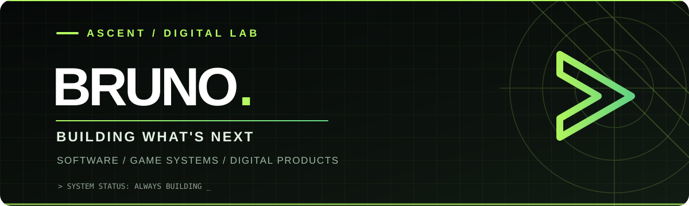

<div align="center">



<br />

**Developer • Digital products • Game systems**  
[@ascentdss](https://github.com/ascentdss)

*I build software, tools and experiences that turn ideas into working products.*

<br />


</div>

---

### `> whoami`

I'm **Bruno**, a builder focused on crafting useful systems and memorable digital experiences. My work connects **web applications, backend infrastructure, developer tools, and Minecraft modding**.

I care about **performance, clean interfaces, practical automation, and the details that make software feel great to use**.

### `> current_projects`

| Project | What I'm building | Area |
| :--- | :--- | :--- |
| **ASCENT UNIVERSE** | Custom multiplayer RPG systems and tools for Minecraft Fabric 1.20.1. | Java · Fabric |
| **ASCENT GO** | A platform for online ordering, delivery operations, inventory, and cost management. | Web · Node.js · MySQL |
| **ASCENT LAUNCHER** | A dedicated desktop launcher and experience for the Ascent ecosystem. | Desktop · Game tools |
| **ASCENT TOOLING** | Tools and workflows for building, customizing, and managing digital content. | Developer tooling |

<sub>Selected work in progress. Some repositories are private; project descriptions do not imply public releases.</sub>

Explore my [public repositories](https://github.com/ascentdss?tab=repositories) and follow new releases.

### `> toolbox`

<div align="center">


</div>

### `> principles`

```txt
01  Build things people can actually use.
02  Keep performance and reliability in focus.
03  Make complex systems feel simple.
04  Improve continuously. Ship thoughtfully.
```

---

<div align="center">

**ASCENT** — *ideas deserve to become real.*

<sub>Designed with purpose · Built to evolve</sub>

</div>
