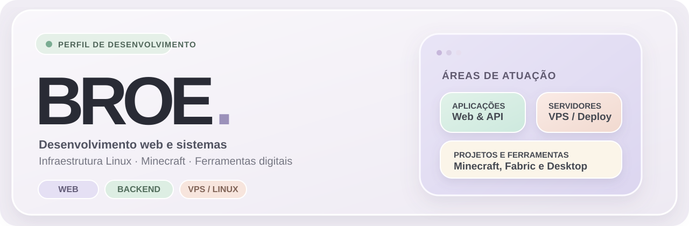
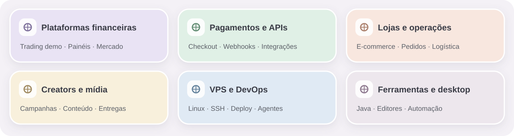
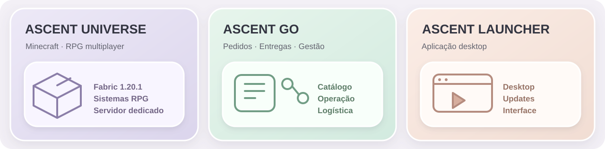

  

  <h3>BROE · Desenvolvimento de sistemas e produtos digitais</h3>

  
Aplicações web · Plataformas financeiras · Sistemas comerciais · APIs · VPS · Automação · Desktop

  

    <a href="#atuacao">Áreas de atuação</a> ·
    <a href="#projetos">Projetos</a> ·
    <a href="#tecnologias">Tecnologias</a> ·
    <a href="#infraestrutura">Infraestrutura</a> ·
    <a href="https://github.com/ascentdss?tab=repositories">Repositórios públicos</a>
  

---

## Sobre

Sou conhecido como **BROE**. Trabalho com desenvolvimento e evolução de plataformas digitais, desde interfaces e experiência do usuário até APIs, banco de dados, integrações externas, administração de servidores e implantação.

Meu portfólio reúne projetos em diferentes fases: **sistemas implementados, plataformas em evolução, integrações em testes e protótipos**. As descrições detalham as tecnologias e os tipos de funcionalidades com os quais já trabalhei, sem representar que todos os recursos estejam disponíveis em produção.

## Áreas de atuação

| Categoria | O que desenvolvo e configuro |
| --- | --- |
| **Aplicações web** | Sites, plataformas, dashboards, landing pages, áreas logadas e interfaces responsivas. |
| **Sistemas comerciais** | Lojas digitais, catálogos, carrinho, checkout, pedidos, gestão de produtos e operações. |
| **Plataformas financeiras** | Interfaces de trading, gráficos, indicadores, simulação de operações, assinaturas e painéis. |
| **Pagamentos e integrações** | APIs de checkout, PIX, webhooks, fluxos de status, conciliação e ambientes sandbox. |
| **Plataformas para criadores** | Campanhas, parcerias, produtos digitais, páginas personalizadas, mídia e painéis. |
| **Backend e banco de dados** | Node.js, APIs, autenticação, regras de negócio, MySQL, consultas e migrações. |
| **VPS e hospedagem** | Linux, SSH, SCP, serviços, publicação, manutenção, logs e ambientes de execução. |
| **Automação e ferramentas** | Painéis operacionais, agentes, fluxos administrativos, ferramentas locais e editores. |
| **Aplicações Java** | Sistemas modulares, comunicação cliente-servidor, interfaces e funcionalidades em tempo real. |
| **Aplicações desktop** | Launchers, utilitários locais, editores de arquivos e processos de instalação/atualização. |
| **Portais e conteúdo** | CMS, páginas públicas, bibliotecas de mídia e organização de publicações. |

---

## 01. Front-end, interfaces e experiência do usuário

- Desenvolvimento de páginas, áreas de usuário, formulários, modais, componentes, listas, filtros, buscas e painéis.
- Interfaces **responsivas** para desktop e mobile, com adaptação de menus, tabelas, botões, imagens e navegação por toque.
- Criação e personalização de temas, incluindo **dark mode, claymorphism, interfaces compactas e componentes com efeitos visuais**.
- Organização de fluxos: cadastro, login, onboarding, escolha de produtos, confirmação de operações, edição de registros e acompanhamento de solicitações.
- Componentes de administração: modais de cadastro e edição, menus laterais, indicadores, estados vazios, feedback de erros e confirmações.
- Atenção a carregamento, legibilidade, contraste, consistência visual, rolagem, desempenho e usabilidade.
- Criação de páginas e telas com **HTML, CSS e JavaScript**, incluindo editores com pré-visualização e personalização de componentes.

## 02. Backend, APIs e banco de dados

- Desenvolvimento com **Node.js** e APIs HTTP para integração entre interface, serviços e persistência.
- Estruturação de rotas, parâmetros, middlewares, validações e regras de autorização.
- Contas de usuário, autenticação, sessões, papéis de acesso e áreas administrativas.
- Modelagem e manutenção de bancos **MySQL**, relações, consultas SQL e evolução de esquemas.
- Regras de negócio para transações, pedidos, estoque, assinaturas, permissões e estados operacionais.
- Tratamento de erros, logging de endpoints, investigação de falhas HTTP, integração e inconsistências de banco.
- Processamento de eventos, callbacks, **webhooks**, registros de auditoria e controles para reduzir operações duplicadas.
- Separação de responsabilidades entre **cliente, servidor e banco de dados**.

## 03. Plataformas financeiras, corretoras e trading

Já trabalhei na construção de interfaces, backends e fluxos de plataformas ligadas a **trading, simulação de mercado e acesso por assinatura**.

| Sistema / recurso | Experiência com |
| --- | --- |
| **STRATTON** | Plataforma OTC em ambiente demonstrativo, com interface de operações, gráficos, ativos, histórico e painel administrativo. |
| **Gráficos financeiros** | Visualização de preços e candles, organização de ativos, séries temporais e indicadores. |
| **Indicadores** | Estudos com médias móveis, RSI, MACD e bandas de Bollinger. |
| **Operações demo** | Fluxos de abertura, registro e histórico de operações simuladas. |
| **Contas e áreas de acesso** | Distinção entre perfis, saldos e acessos relacionados a ambientes demo/real, conforme o sistema. |
| **Lottus Trading** | Fluxos de checkout por assinatura, confirmação de pagamento e integração com a plataforma Avalon. |
| **Integrações externas** | Webhooks, APIs de plataformas, atualização de status e vinculação de contas. |
| **Administração** | Interfaces para gestão, acompanhamento de eventos e configuração de recursos. |

**Tecnologias e abordagens utilizadas nos projetos:** JavaScript, React/Vite, Node.js/Express, MySQL, WebSocket e interfaces de gráficos.

> **Escopo:** STRATTON inclui funcionalidades demonstrativas. Trabalhar em software financeiro e integrações não significa operar uma instituição financeira ou corretora regulada, nem comprova que todos os recursos foram lançados comercialmente.

## 04. Sistemas de pagamentos, checkout e infraestrutura financeira

**Projetos relacionados:** **Graffit Pay** e estudos de arquitetura do **BROE Pay**.

- Desenvolvimento e integração de **APIs de pagamentos** e sessões de checkout.
- Fluxos de **PIX**, criação de cobranças e acompanhamento de status.
- Recebimento e tratamento de **webhooks** de provedores, confirmação de eventos e atualização de registros.
- Integrações com provedores externos, credenciais e ambientes de teste.
- Organização de comerciantes, clientes, identificadores de transação e referências externas.
- Estudo e implementação de componentes como **payment intents, ledger, conciliação, roteamento de provedores e idempotência**, conforme a evolução de cada projeto.
- Desenvolvimento de módulos relacionados a **carteiras gerenciadas, ativos digitais e liquidação**, com integrações em sandbox.
- Registros operacionais, chaves de API, permissões, auditoria e tratamento de falhas.

**Graffit Pay** é um projeto de infraestrutura de pagamentos baseado em APIs, com módulos próprios e integrações externas. Parte das funcionalidades e validações passou por ambiente de testes; isso não representa uma oferta pública de serviços financeiros nem autorização regulatória.

**BROE Pay** foi trabalhado como proposta/arquitetura de orquestração de checkout e provedores; não está apresentado aqui como produto comercial concluído.

## 05. Comércio eletrônico, lojas e operação de pedidos

**Projetos relacionados:** **Ascent GO** e **Ascent Shop**.

### Para o cliente

- Navegação por categorias e produtos, descrições, fotos, preços e adicionais.
- Configuração de itens, quantidades, complementos, carrinho e resumo de valores.
- Escolha entre **entrega e retirada**, preenchimento de endereço e confirmação de localização.
- Formas de pagamento como **PIX, débito, crédito e dinheiro com troco**, conforme o fluxo.
- Validação do pedido, registro e acompanhamento das mudanças de status.
- Mensagens e links de acompanhamento e integração com canais como WhatsApp.

### Para a empresa

- Painéis de pedidos recebidos, em preparo, prontos, em entrega e concluídos.
- Cadastro de lojas, categorias, produtos, variações, adicionais e regras de seleção.
- Gestão de insumos, unidades, receitas, **custo de mercadoria vendida (CMV)**, margem e precificação.
- Gestão de estoque, saídas, custos por item e dados de operação.
- Confirmações de pagamento, situações excepcionais e controles administrativos.
- Organização de telas e ações para operadores e proprietários.

### Para logística e entregas

- Listagem de entregas disponíveis, dados de destino e atualização de andamento.
- Geolocalização, autocomplete de endereços, mapas, rotas e integração com serviços como **Geoapify**.
- Abertura de navegação externa e confirmação da conclusão de uma entrega.

O **Ascent GO** reúne o desenvolvimento desses fluxos. O **Ascent Shop** é outro projeto de loja/plataforma comercial; seu repositório privado está atualmente organizado para arquivamento/restauração, sem afirmação de publicação comercial ativa.

## 06. Plataformas de criadores, parceiros e marketing

**Projeto relacionado:** **Ascent Creators**.

- Estrutura de contas e painéis para **administradores, criadores e empresas**.
- Cadastro e gerenciamento de campanhas, colaboração entre participantes e inscrições.
- Aprovação de candidaturas e acompanhamento das etapas de uma campanha.
- **Páginas personalizadas** com editor HTML/CSS/JS, pré-visualização e separação entre rascunho e publicação.
- Lojas de criadores, produtos digitais e formas de entrega como **códigos, chaves, links, textos e arquivos**.
- Organização de cupons, conteúdo promocional, pedidos e fluxos comerciais.
- Bibliotecas de mídia para imagens e vídeos, pré-visualização, organização e download de originais.
- Interfaces de tarefas, agenda, comunicação, acompanhamento e métricas.
- Integrações estudadas ou implementadas conforme versão: **OAuth, e-mail, pagamentos, PIX e canais de conteúdo**.
- Administração de permissões, logs, segurança e manutenção de arquivos.

**Stack trabalhada:** Node.js, MySQL, HTML, CSS, JavaScript e integrações web.

## 07. Jornada do cliente e lógica operacional

Além das interfaces, trabalho no desenho de **fluxos completos entre diferentes perfis**.

| Perfil / jornada | Exemplos de etapas |
| --- | --- |
| **Visitante → cliente** | Entrada na página, cadastro/login, navegação, seleção, checkout e confirmação. |
| **Cliente recorrente** | Autenticação, histórico, status de pedidos, acesso a recursos e dados próprios. |
| **Assinante de plataforma** | Escolha de plano, checkout externo, webhook de aprovação e liberação de acesso. |
| **Operador comercial** | Recebimento, conferência, preparo, validação, alteração de estado e conclusão. |
| **Entregador** | Acesso a pedidos, consulta de rota, atualização de execução e finalização. |
| **Criador de conteúdo** | Cadastro, participação em campanhas, administração de páginas e produtos digitais. |
| **Gestor / administrador** | Permissões, configuração, acompanhamento de eventos, usuários, registros e relatórios. |
| **Operação via API** | Requisição, validação de dados, processamento, resposta, logs e atualização persistente. |

Também considero os estados intermediários: erro de validação, pagamento ainda não confirmado, dados incompletos, duplicidade de eventos e necessidade de recuperar uma operação interrompida.

## 08. VPS, servidores, hospedagem e DevOps

Trabalho com ambientes **Windows e Linux**, incluindo administração remota, configuração, deploy e diagnóstico.

| Categoria | Experiência |
| --- | --- |
| **VPS Linux** | Preparação de máquinas Ubuntu, instalação de dependências e organização de ambientes. |
| **SSH / SCP** | Conexões remotas, autenticação por chave, transferência de arquivos e atualização de aplicações. |
| **Serviços de sistema** | Configuração e operação de serviços com `systemd`, inicialização, reinício e diagnóstico. |
| **Usuários e permissões** | Propriedade de diretórios, grupos de acesso e resolução de erros de permissão. |
| **Node.js em hospedagem** | Publicação, configurações de entrada, variáveis de ambiente e leitura de logs. |
| **MySQL hospedado** | Configuração de conexão, erros de consulta, acesso e manutenção de esquemas. |
| **Versionamento** | Git, repositórios, branches, atualizações e histórico de mudanças. |
| **Deploy** | Preparação de build, transferência/implantação e verificação após publicação. |
| **Monitoramento** | Logs da aplicação, análise de processos, respostas HTTP e problemas de desempenho. |
| **Segurança operacional** | Separação de credenciais, arquivos privados, permissões e cuidados com dados sensíveis. |

**Ambientes com os quais já trabalhei:** Ubuntu 24.04, VPS Contabo, Hostinger Node.js/MySQL e PowerShell no Windows.

### Ascent Host e automação de infraestrutura

Projeto de painel de administração e integração com **agentes de infraestrutura**, envolvendo comunicação entre painel e máquina, configuração remota, gestão de instâncias, arquivos e diagnóstico. O desenvolvimento incluiu preocupações com autenticação, logs, intervalos de comunicação, estado de serviços e desempenho.

## 09. Ferramentas desktop, launchers e editores

- **Ascent Launcher:** aplicativo desktop com interface própria, preparação de instalador, organização de atualização e execução.
- **Ascent Model Forge Desktop:** editor local de estruturas/modelos com importação de **JSON/PNG**, visualização 3D, pintura de textura, edição de propriedades e exportação de arquivos.
- **Universal UI Studio:** editor visual para criar e ajustar telas HTML/CSS/JS com componentes, camadas, inspetor, pré-visualização e exportação.
- **Ferramentas de diagnóstico:** painéis de logs, exportação de dados e suporte à investigação de falhas.
- **Ferramentas para automação local:** fluxos de arquivos, edição de recursos e utilitários de preparação de ambientes.
- **Aplicações com recursos de navegador integrado:** uso de componentes web em aplicativos e comunicação entre interface e lógica nativa.

Esses projetos incluem aplicações em estágios diferentes, de protótipos locais a sistemas com interfaces e módulos desenvolvidos.

## 10. Java, sistemas cliente-servidor e aplicações interativas

- Desenvolvimento de módulos, eventos, regras de negócio e interfaces com **Java**.
- Comunicação e separação de responsabilidades entre **cliente e servidor**.
- Validação de operações no servidor, permissões por usuário e sincronização de estados.
- Sistemas de cadastro de entidades, atributos, progressão e regras personalizadas.
- Interfaces HTML/CSS/JS integradas a aplicações Java por **bridges e callbacks**.
- Importação e registro de recursos, arquivos JSON e texturas PNG.
- Execução em processos dedicados, depuração por logs e atenção ao desempenho.
- Organização de componentes reutilizáveis, ferramentas administrativas e editores de conteúdo.
- Uso de **Gradle**, estruturas de projeto Java e gerenciamento de dependências.

## 11. Integrações, automação e ferramentas operacionais

| Tipo de integração | Exemplos de trabalho |
| --- | --- |
| **APIs REST** | Consulta, criação e alteração de dados entre plataformas. |
| **Webhooks** | Eventos de pagamentos, assinaturas, notificações e atualizações de status. |
| **Comunicação em tempo real** | Atualização de interfaces, dados e eventos com tecnologias como WebSocket. |
| **Rotas e endereços** | Geocodificação, autocomplete, coordenadas, mapas e navegação. |
| **Arquivos e mídia** | Upload, leitura, pré-visualização, armazenamento e exportação. |
| **Mensageria e canais** | Fluxos de comunicação com WhatsApp, e-mail e serviços externos. |
| **Agentes e painéis** | Comunicação com serviços remotos, telemetria e tarefas administrativas. |
| **Atualizações e builds** | Empacotamento, organização de versões, testes e implantação. |

## 12. Dados, relatórios e ferramentas administrativas

- Dashboards e painéis para acompanhamento de operações.
- Filtros, buscas, paginação, organização e edição de registros.
- Indicadores e relatórios de **pedidos, custos, margens, estoque e campanhas**.
- Históricos de operações demonstrativas, pagamentos, assinaturas e eventos do sistema.
- Cálculos financeiros aplicados a software: preços, taxas, margens e composição de custos.
- Logs de aplicação, trilhas de eventos, mensagens de erro e diagnósticos.
- Telas de configuração, permissões, estados e controle de usuários.

## 13. Sites, portais, mídia e publicação de conteúdo

- Desenvolvimento e manutenção de páginas institucionais e landing pages.
- Personalização de telas e experiências de navegação em portais.
- Organização de conteúdo, categorias, bibliotecas de mídia e arquivos.
- Trabalhos envolvendo **WordPress/PHP** e soluções desenvolvidas sob medida.
- **De Olho em CG:** projeto relacionado a portal de conteúdo local.
- Componentes para imagens, vídeos, arquivos e páginas personalizadas.
- Interfaces de administração e publicação de conteúdo.

## Projetos e sistemas

| Projeto | Tipo | Descrição |
| --- | --- | --- |
| **STRATTON** | Plataforma financeira | Interface de trading OTC, ativos, gráficos, indicadores, operações demo e administração. |
| **Lottus Trading** | Trading / assinaturas | Fluxos de checkout, webhook, confirmação de assinatura e integração com plataforma externa. |
| **Graffit Pay** | Infraestrutura de pagamentos | APIs, checkout, integração com provedores, registros, webhooks e recursos financeiros em validação. |
| **BROE Pay** | Arquitetura / protótipo | Estudo de orquestração de pagamentos, PIX, provedores e liquidação com ativos digitais. |
| **Ascent Creators** | Plataforma de criadores | Campanhas, lojas de produtos digitais, páginas, mídia, criadores, empresas e administração. |
| **Ascent Shop** | Loja digital | Plataforma comercial e trabalho com estrutura de loja e operações de venda. |
| **Ascent GO** | Comércio e delivery | Catálogo, pedidos, localização, pagamentos, entregas, estoque e CMV. |
| **Ascent Host** | Infraestrutura / VPS | Painel e integração de agentes para administração de ambientes e serviços. |
| **Ascent Universe** | Software Java | Sistemas modulares, interfaces, regras personalizadas e comunicação cliente-servidor. |
| **Ascent Launcher** | Aplicação desktop | Launcher, instalador, experiência de uso e organização de versões. |
| **Ascent Model Forge Desktop** | Editor local | Edição e visualização de modelos/recursos em JSON e PNG. |
| **Universal UI Studio** | Editor de interfaces | Construção e pré-visualização visual de telas HTML/CSS/JS. |
| **De Olho em CG** | Portal web | Projeto de conteúdo e publicação local. |
| **Projetos de sites** | Web | Páginas, apresentações institucionais e personalizações de interface. |

> **Status dos projetos:** a tabela reúne experiências de desenvolvimento em fases diferentes, inclusive protótipos, integrações sandbox, sistemas em manutenção e projetos arquivados. Não indica que todas as plataformas estejam publicadas, completas ou disponíveis para uso comercial.

## Tecnologias e ferramentas

| Categoria | Ferramentas e tecnologias |
| --- | --- |
| **Linguagens** | Java, JavaScript, HTML, CSS, SQL, PHP |
| **Frontend** | React, Vite, HTML/CSS/JS, interfaces responsivas |
| **Backend** | Node.js, Express, REST API, WebSocket |
| **Dados** | MySQL, consultas SQL, modelagem e migrações |
| **Infraestrutura** | Linux, Ubuntu, VPS, SSH, SCP, `systemd` |
| **Deploy** | Git, GitHub, Hostinger, VPS Contabo, builds e manutenção |
| **Ambiente local** | Windows, PowerShell, Neovim, LazyVim, LSP, tmux |
| **Java e build** | Java, Gradle, módulos e comunicação cliente-servidor |
| **Interfaces e arquivos** | SVG, JSON, PNG, editores visuais, ferramentas 3D |
| **Integrações** | Webhooks, APIs financeiras, autenticação, geolocalização, Geoapify |
| **Experiência visual** | Design responsivo, claymorphism, componentes, temas e dashboards |

---

  
<strong>BROE</strong> Desenvolvimento web · Plataformas · APIs · Infraestrutura · Java · Desktop

  
<a href="https://github.com/ascentdss?tab=repositories">Ver repositórios públicos</a>

