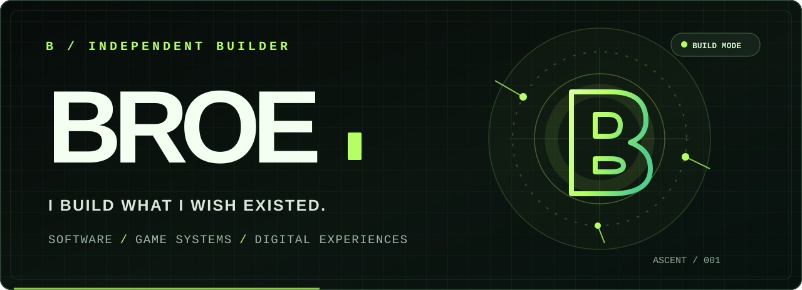
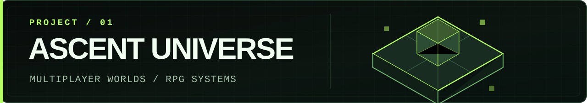
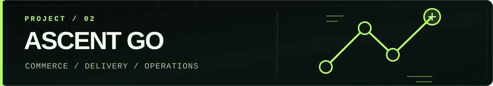
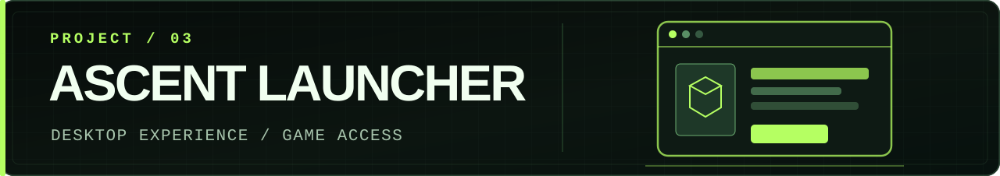
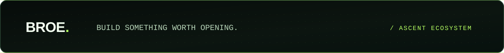

<!--
  BROE / ASCENT — handcrafted GitHub profile
  All visual assets are local SVGs. No trackers, fabricated stats, or third-party widgets.
-->

<div align="center">
  

  <p>
    <samp>INDEPENDENT BUILDER</samp>
    &nbsp; · &nbsp;
    <samp>DESIGN × ENGINEERING</samp>
    &nbsp; · &nbsp;
    <samp>ASCENT ECOSYSTEM</samp>
  </p>

  <h2>Ideas are easy. Building them is the point.</h2>

  <p>
    Desenvolvo plataformas, ferramentas e sistemas que saem do conceito e viram experiências reais.<br/>
    <b>Software que resolve. Interfaces com identidade. Mundos que ganham vida.</b>
  </p>

  <p>
    <a href="#selected-builds"><strong>EXPLORE THE BUILDS</strong></a>
    &nbsp; · &nbsp;
    <a href="#the-toolkit"><strong>THE TOOLKIT</strong></a>
    &nbsp; · &nbsp;
    <a href="https://github.com/ascentdss?tab=repositories"><strong>PUBLIC CODE</strong></a>
  </p>
</div>

---

### <samp>01 / THE MINDSET</samp>

> **Não construo só telas. Construo o sistema por trás delas.**

Sou **BROE**, criador de produtos digitais e do ecossistema **ASCENT**. Meu trabalho cruza desenvolvimento web, sistemas multiplayer, automações, infraestrutura e ferramentas próprias.

O objetivo é simples: **fazer o complexo funcionar de forma fluida, útil e memorável.**

---

### <samp>02 / SELECTED BUILDS</samp>

<a id="selected-builds"></a>
<details open>
<summary><b>ASCENT / THREE WORLDS IN PROGRESS</b></summary>

<br/>



**Um mundo com suas próprias regras.** Desenvolvimento de sistemas RPG multiplayer para Minecraft Fabric 1.20.1: personagens, classes, progressão, equipamentos, interfaces e ferramentas de administração.

`JAVA` &nbsp; `FABRIC` &nbsp; `MULTIPLAYER` &nbsp; `GAME SYSTEMS`

<br/>



**Operação real, sem complicação.** Plataforma de pedidos e entregas com fluxo de atendimento, logística, estoque, custos e gestão do negócio.

`WEB` &nbsp; `NODE.JS` &nbsp; `MYSQL` &nbsp; `OPERATIONS`

<br/>



**A entrada também faz parte da experiência.** Launcher desktop para unificar acesso, distribuição e a experiência do universo Ascent.

`DESKTOP` &nbsp; `LAUNCHER` &nbsp; `USER EXPERIENCE` &nbsp; `TOOLING`

</details>

<sub>Projetos em desenvolvimento. Alguns repositórios são privados; as descrições acima são uma visão pública do trabalho.</sub>

---

### <samp>03 / THE TOOLKIT</samp>

<a id="the-toolkit"></a>

```text
LANGUAGES     Java  /  JavaScript
BACKEND       Node.js  /  MySQL
GAME DEV      Fabric  /  Multiplayer Systems
ENVIRONMENT   Linux  /  Git  /  Neovim
PRIORITIES    Performance  /  Experience  /  Reliability
```

**Do protótipo à produção.** Arquitetura, lógica, integração, interface e infraestrutura — com atenção à fluidez e aos detalhes.

---

### <samp>04 / DESIGN PRINCIPLES</samp>

<details>
<summary><b>▸ READ THE BUILD MANIFEST</b></summary>

<br/>

```txt
01  BUILD > HYPE
02  PERFORMANCE IS A FEATURE
03  COMPLEXITY BELONGS BEHIND THE INTERFACE
04  EVERY DETAIL CHANGES THE EXPERIENCE
05  KEEP LEARNING. KEEP SHIPPING.
```

O melhor sistema não é o que promete mais. É o que entrega uma experiência melhor.

</details>

---

<div align="center">

  <p><samp>LESS TEMPLATE. MORE IDENTITY.</samp></p>

  <a href="https://github.com/ascentdss?tab=repositories"><b>EXPLORE PUBLIC REPOSITORIES</b></a>
  &nbsp; · &nbsp;
  <a href="https://github.com/ascentdss"><b>FOLLOW BROE</b></a>

  <br/><br/>

  
</div>
